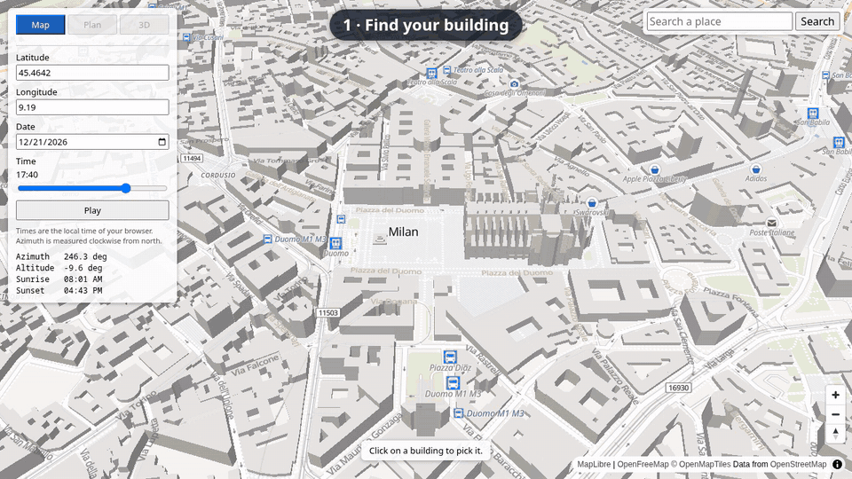
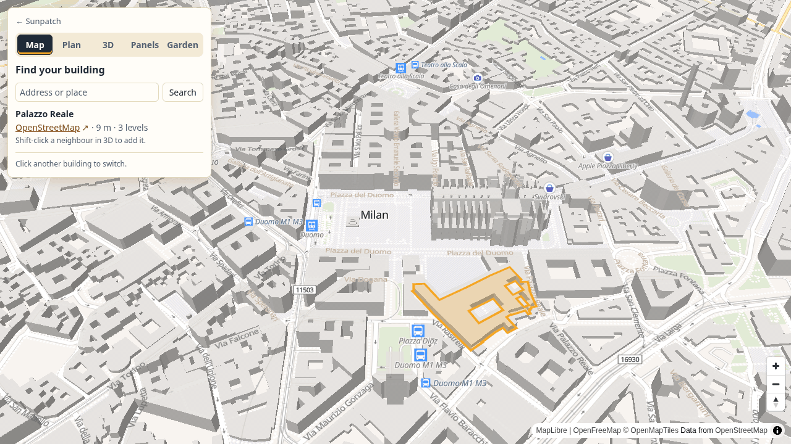
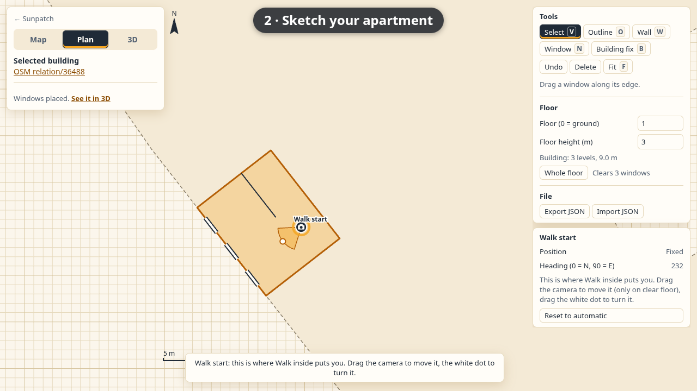
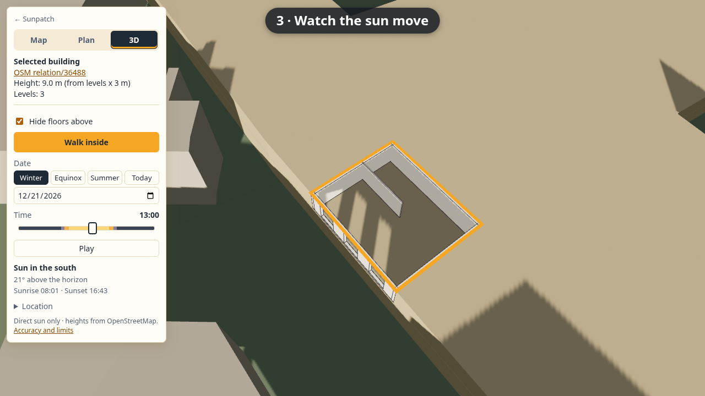
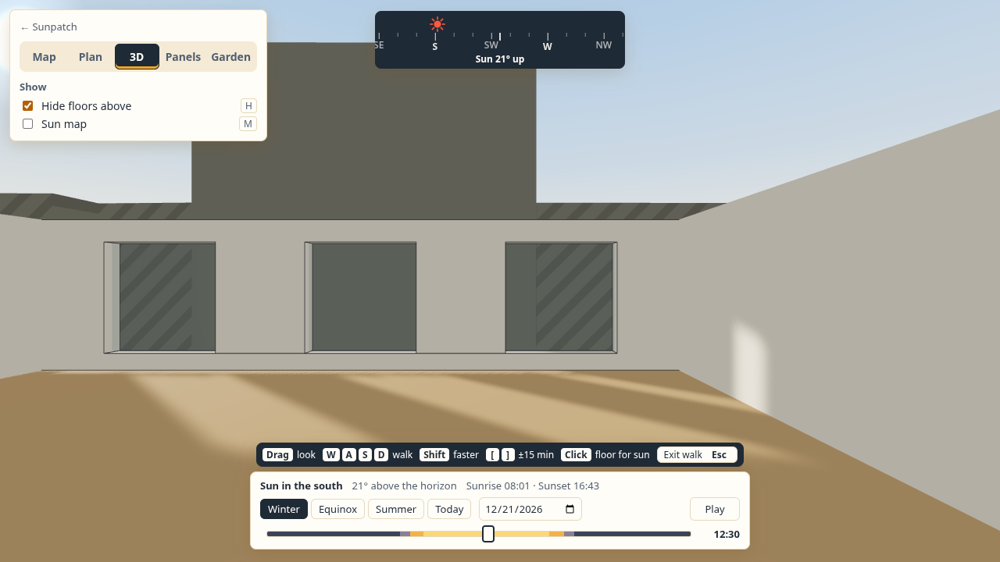

# Sunpatch

See where the sun comes into your home: pick your building on a map, sketch your apartment and its windows,
then walk inside in 3D and watch the sun patches move across the floor for any day of the year.

[](docs/demo.mp4)

*Click the animation for the full video (45 s).*

Sunpatch runs entirely in the browser. Building footprints and heights come from
[OpenStreetMap](https://www.openstreetmap.org/), the sun position from [SunCalc](https://github.com/mourner/suncalc),
and the 3D scene is rendered with [three.js](https://threejs.org/). No account or API key is needed.

## Features

- **Find your building** on an OpenStreetMap map, by address search or by clicking it. The 3D view opens at once
  from the map's own building data, and the detailed OpenStreetMap buildings load in the background.
- **Real neighbourhood shadows**: every building within about 300 m is modelled, so the blocks across the street
  shade your windows just like in reality.
- **Sketch your apartment** in a top-down plan editor: choose the floor, draw the outline (it snaps to the
  building's walls), add interior walls and place windows with their width, sill and height.
- **Fix the building** where OpenStreetMap is incomplete: add a missing balcony or a protruding wall, or cut away a
  recess. Fixes cast shadows like the rest of the building.
- **Watch the sun move**: pick a date and a time, or press Play to run through the day. A cutaway view hides the
  floors above so you can look into your rooms from outside.
- **Walk inside** in first person at eye height, see the sun disc through the windows and step the time while you
  look around.
- Plans are saved in the browser automatically and can be exported and imported as JSON.

| | |
|---|---|
|  |  |
| Pick a building on the map | Sketch the floor plan and windows |
|  |  |
| 3D cutaway with neighbourhood shadows | Walk inside and see the sun patches |

## Quick start

You need [Node.js](https://nodejs.org/) 22.12 or newer.

```sh
git clone https://github.com/rodolfocarobene/sunpatch.git
cd sunpatch
npm install
npm run dev
```

Then open the address Vite prints (normally <http://localhost:5173>). That is the landing page; the app is at
`/app/`, and `/app/?example=milan` opens a bundled sample apartment in 3D without any map click or network request
for buildings.

To build a static site, run `npm run build` (add `-- --base=./` to host it under a sub-path, as GitHub Pages does).
The output in `dist/` can be served by any static host; the app is at `dist/app/`.

## How to use it

1. **Map**: search an address or move the map, then click your building. The app switches to the 3D view.
   Your building is every outline that touches the one you clicked, so it may include neighbours of other
   heights. In 3D, **Shift-click** a building to add it to the selection or take it out.
   To work on another building, click it in 3D (it lights up when you point at it), or click a grey neighbour in Plan with the Select tool.
   Your plan is saved first.
2. **Plan**: set the floor (0 is the ground floor) and check the floor height, which is estimated from the
   OpenStreetMap data. Then:
   - **Outline**: click the corners of your apartment; double-click or click the first point to close it.
     **Whole floor** resets it to the full footprint.
   - **Wall**: two clicks per interior wall; hold Shift for right angles.
   - **Window**: click on an outline edge. With **Select** you can drag a window along its wall and edit its size.
   - **Building fix**: draw a shape, choose Add or Cut, and set its heights or use a preset such as
     *Balcony slab on this floor*.
   - The camera symbol shows where **Walk inside** will put you. Drag it to move it and drag its white dot to
     turn it.
3. **3D**: drag to orbit, scroll to zoom, right-drag to pan. Set the date and move the time slider, or press
   **Play**. Keep **Hide floors above** on to see inside.
4. **Walk inside** (or double-click the apartment floor): drag to look, WASD or arrow keys to walk, Shift to go
   faster, `[` and `]` to move the time by 15 minutes, `P` to play or pause, `Esc` to leave. `H` (or the
   **Floors above** button) hides or shows the floors above; it is the same switch as in the 3D panel. Hidden,
   you see the sky through the ceiling, and the sun still comes in only through the windows.

Times are in your browser's time zone, so use the app from the same time zone as the place you are looking at.

## Accuracy and limitations

The sun position and the direct-sun geometry are accurate; how good the result is mostly depends on the
building data.

- Heights come from OpenStreetMap `height` tags when present, otherwise from the number of floors × 3 m,
  otherwise a 9 m default. The selected building's info box says which one was used. Wrong heights move
  shadows by metres, so check your neighbours on the map.
- Roofs are flat, and trees, awnings and most balconies are missing. Use **Building fix** for the ones that matter
  to you.
- Only direct sunlight is simulated. The general brightness of the rooms is a simple stand-in for light bouncing
  around, not a measurement.
- Distant terrain (hills, mountains) is not modelled yet, so very low sun near sunrise and sunset may be
  reported as reaching you when a ridge would block it.
- The public Overpass servers are sometimes busy. When they fail you keep the map-tile buildings, which have
  heights but no floor counts, and can retry.

## How it works

1. **Picking**: MapLibre GL JS shows OpenFreeMap vector tiles. On a click, the buildings already loaded in the
   tiles are turned into an instant 3D preview. The app then asks the Overpass API for the OpenStreetMap
   buildings within 350 m, trying several mirrors in turn, and swaps them in without moving the camera.
2. **Scene**: footprints are projected to local metres around the selected building (x east, y up, z south)
   and extruded with three.js. Buildings with separately mapped parts (`building:part`) are drawn from their
   parts.
3. **Sun**: SunCalc gives the sun's azimuth and altitude for the chosen place and time. A directional light
   placed in that direction casts shadow maps.
4. **Apartment**: the plan replaces the selected building with the floors below, the floors above, the rest of
   your storey, and your apartment's walls with real window openings. Building fixes are added or carved out
   per height range with `polygon-clipping`.
5. **Sharp patches**: a second, narrow sun light covers only your building with a high-resolution shadow map,
   rendered in a second pass so the room gets centimetre-level sun patches without lighting anything twice.

More detail for contributors is in [docs/ARCHITECTURE.md](docs/ARCHITECTURE.md).

## Development

```sh
npm test          # unit tests (Vitest)
npm run build     # type-check and production build
npm run shots:install   # once: download a headless Chromium into .browsers/
npm run shots -- out/   # render the main flow to PNGs (uses a recorded Overpass response)
npm run demo      # re-record the demo video and screenshots in docs/ (needs ffmpeg)
```

The landing page (`index.html`, `src/landing.css`, media in `public/media/`) and the app (`app/index.html`) are
separate pages of one Vite multi-page build (`vite.config.ts`). `src/example.ts` builds the Milan example from the
bundled fixture; its edits are never autosaved.

`npm run dev` also serves two pages that are handy while working on one part in isolation:
`/dev/editor.html` (plan editor on a test building) and `/dev/apartment.html` (a test apartment; try
`?walk=1&edits=1`).

See [CONTRIBUTING.md](CONTRIBUTING.md) for conventions.

## Roadmap

- Terrain horizon from an elevation model, so hills and mountains block the low sun.
- A sun-hours heat map of the floor for a day or a season.
- Time zone of the chosen place instead of the browser's.

## Data and attribution

- Map data © [OpenStreetMap contributors](https://www.openstreetmap.org/copyright), available under the
  [Open Database License](https://opendatacommons.org/licenses/odbl/). This includes the recorded test data in
  `fixtures/`.
- Map tiles by [OpenFreeMap](https://openfreemap.org/), using the [OpenMapTiles](https://openmaptiles.org/) schema.
- Address search by [Nominatim](https://nominatim.org/) and building data by the [Overpass API](https://overpass-api.de/)
  and its mirrors. Please respect their usage policies: the app sends one search per submit and one Overpass
  query per picked building, and caches the results.

## License

[MIT](LICENSE) © 2026 Rodolfo Carobene
