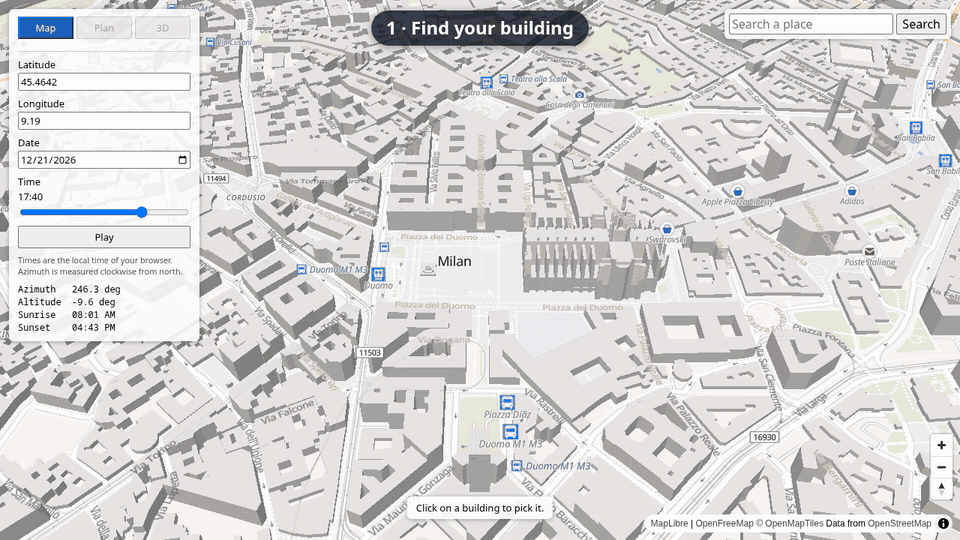
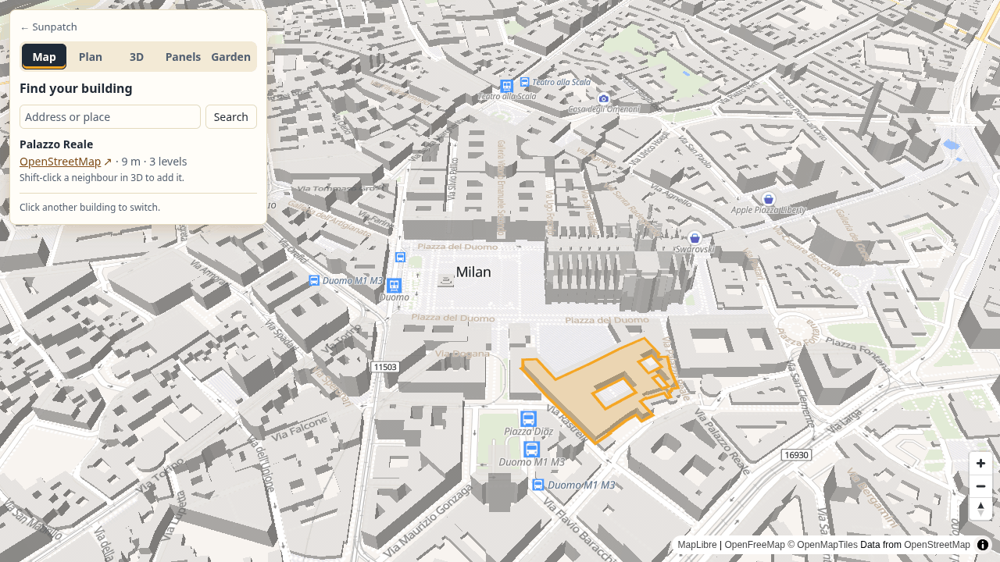
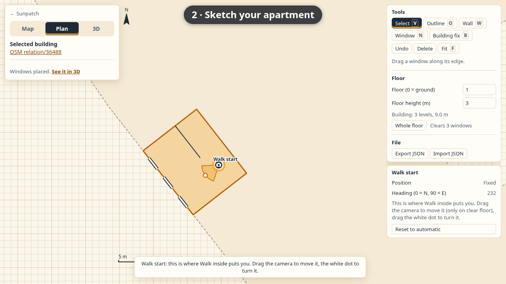
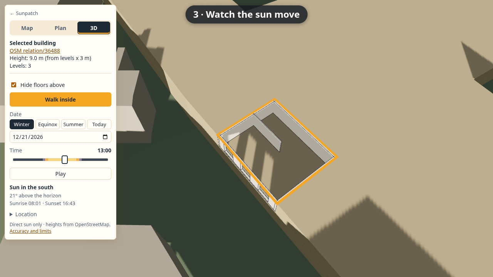
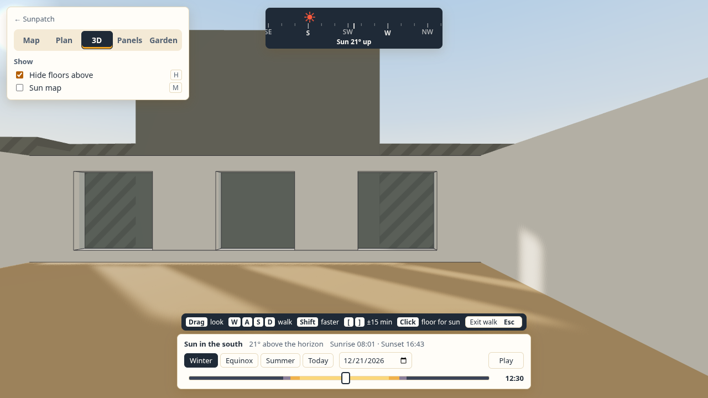
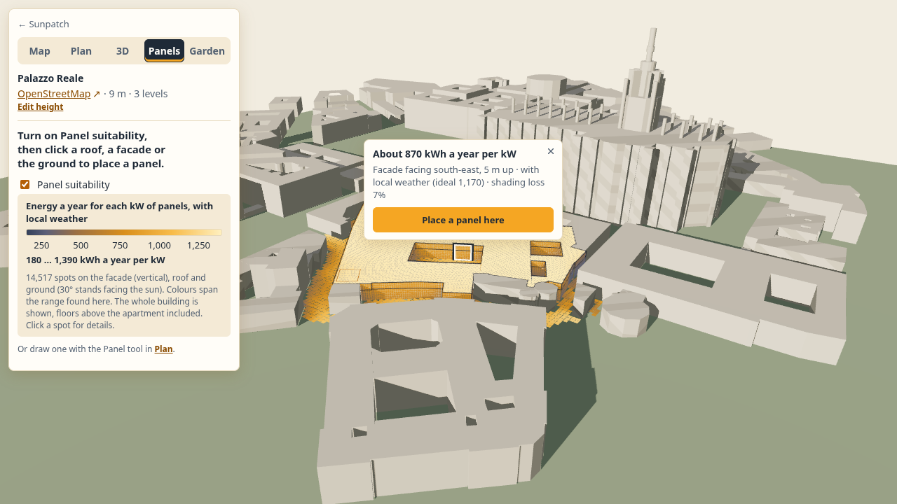
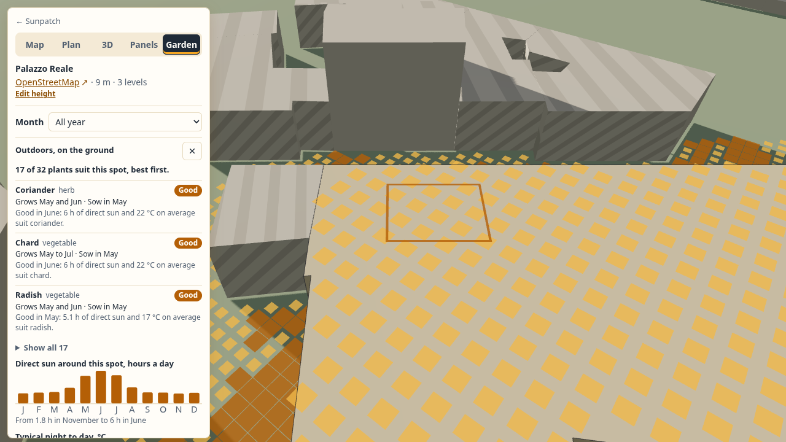

# Sunpatch

See where the sun comes into your home: pick your building on a map, sketch your apartment and its windows,
then walk inside in 3D and watch the sun patches move across the floor for any day of the year.

**Try it: <https://rodolfocarobene.github.io/sunpatch/>** ·
[sample apartment in Milan](https://rodolfocarobene.github.io/sunpatch/app/?example=milan) ·
[in italiano](https://rodolfocarobene.github.io/sunpatch/it/)

[](docs/demo.mp4)

Free, in the browser, no account or API key. Plans stay on your device.

## Features

- **Map**: find your building on an OpenStreetMap map by address or by clicking it.
- **Plan**: sketch the apartment on the building's footprint: floor, outline, interior walls, windows, and fixes
  for balconies or recesses that OpenStreetMap is missing.
- **3D**: real neighbourhood shadows (buildings and trees within about 300 m) for any date and time, with a
  one-line answer such as "Sun inside on 21 Dec: 10:20–13:35 · 3 h 15 min", a sun-hours map of the floor, a
  month-by-month chart and a first-person walk inside.
- **Panels**: a map of where solar panels would do best on the roof, facades and ground, and the yearly energy of
  each panel you place, with local weather.
- **Garden**: click a spot to see which of about 120 plants would grow there, month by month, or pick a plant and
  see the best spots for it.
- **Daylight (estimate)**: a separate, clearly labelled overcast-sky estimate, never mixed into the direct-sun
  numbers.
- Wrong building height? Right-click any building in 3D to correct it.
- Share a plan as a link (everything is in the URL, nothing is uploaded), or export and import it as JSON.
- English and Italian; works on phones except walking.

| | |
|---|---|
|  |  |
|  |  |
|  |  |

## Accuracy and limits

The sun position and direct-sun geometry are accurate; the result mostly depends on the building data.

- Heights come from OpenStreetMap; where missing, 9 m is assumed and the building is drawn striped.
- Roofs are flat, trees are rough, and distant terrain (hills, mountains) is not modelled yet.
- Panel energy, plant ratings and the daylight layer are estimates from typical values.
- Times are in your browser's time zone.

## Run it locally

Needs [Node.js](https://nodejs.org/) 22.12 or newer.

```sh
git clone https://github.com/rodolfocarobene/sunpatch.git
cd sunpatch
npm install
npm run dev       # landing page at /, app at /app/
npm test          # unit tests (Vitest)
npm run build     # type-check and static build in dist/
```

How it works is in [docs/ARCHITECTURE.md](docs/ARCHITECTURE.md); conventions are in
[CONTRIBUTING.md](CONTRIBUTING.md).

## Data and attribution

- Map data © [OpenStreetMap contributors](https://www.openstreetmap.org/copyright), under the
  [Open Database License](https://opendatacommons.org/licenses/odbl/) (including the test data in `fixtures/`).
- Map tiles by [OpenFreeMap](https://openfreemap.org/) ([OpenMapTiles](https://openmaptiles.org/) schema).
- Address search by [Nominatim](https://nominatim.org/), buildings by the [Overpass API](https://overpass-api.de/).
- Climate averages from [NASA POWER](https://power.larc.nasa.gov/).
- Plant summaries and pictures from [Wikipedia](https://www.wikipedia.org/) and
  [Wikimedia Commons](https://commons.wikimedia.org/), credited on each card.
- Built with [three.js](https://threejs.org/), [MapLibre GL JS](https://maplibre.org/),
  [SunCalc](https://github.com/mourner/suncalc) and [three-mesh-bvh](https://github.com/gkjohnson/three-mesh-bvh).

## License

[MIT](LICENSE) © 2026 Rodolfo Carobene
